<h2 data-importer="text" align="left"></h2>

###

<h2 data-importer="text" align="left">Hi 👋! My name is Esmail Fareed and I'm a  Devops Engineer</h2>

###

<h2 data-importer="text" align="left"></h2>

###

###

👨‍💻 About Me  👨‍💻 Junior DevOps Engineer & Cloud Infrastructure Enthusiast    🧠 Gaining hands-on experience in AWS, Kubernetes, and Terraform infrastructure automation    🔍 Worked with multi-tier architectures, container orchestration, and GitOps continuous delivery 🛠 Provisioning cloud resources, configuring monitoring via Prometheus, and streamlining deployments   🚀 Strong foundation in system administration, CI/CD pipelines, and application containerization    🌱 Focused on improving system reliability, optimizing deployments, and writing clean automation code

###

<h2 data-importer="text" align="left">🛠 Tech Stack</h2>

###

  
  
  
  
  
  
  
  
  
  
  
  
  
  
  
  
  
  
  
  
  
  
  
  
  
  
  

###

<h2 data-importer="text" align="left">🛠 Connect with me:</h2>

###

  
  
  

###

  
  

###

###
